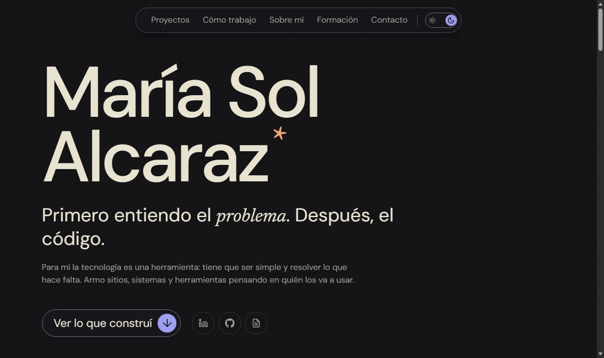
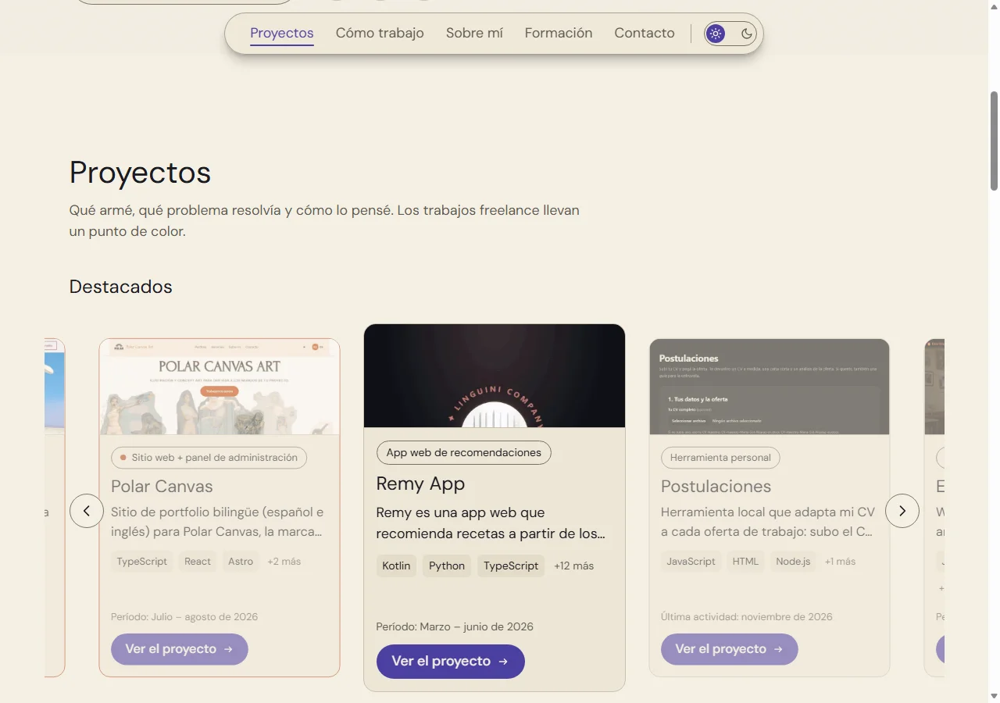
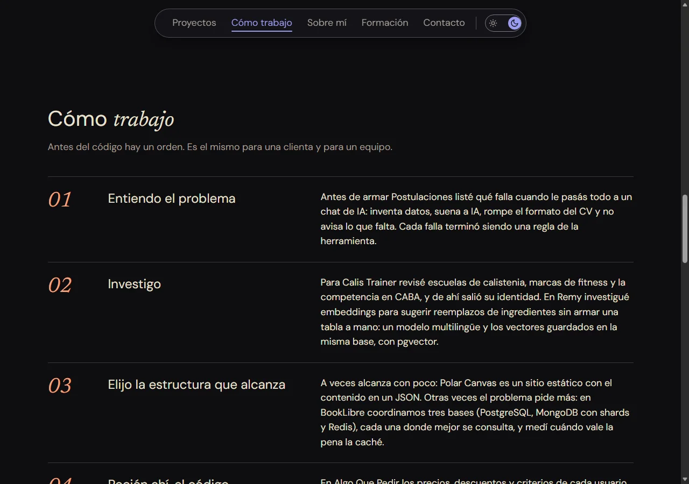
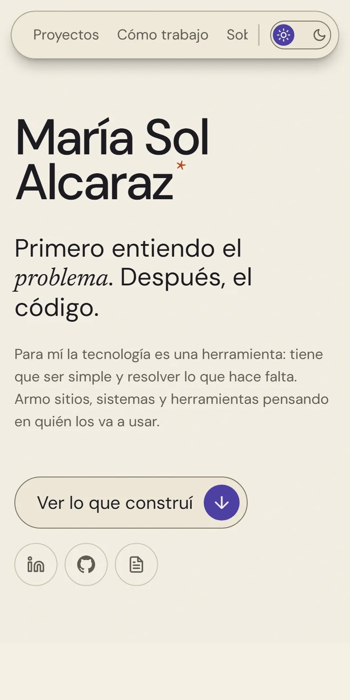

# Portfolio de María Sol Alcaraz

Mi sitio personal, en español: una sola web para quien arma un equipo y para quien tiene un proyecto en mente. Los proyectos aparecen solos, como cards, leídos desde GitHub. Lo armé con Claude Code como herramienta de desarrollo; las decisiones de diseño, de contenido y de estructura las tomé yo.

## Problema que resuelve

Quería una carta de presentación que no parezca abandonada aunque yo no la toque. Por eso cada proyecto se lee de GitHub al armar el sitio y muestra su fecha real de actividad, y lo que cambia cada tanto (cursos, charlas) vive en un solo archivo. Evité las frases fechadas que se vuelven viejas.

El desafío técnico fue que esa información viniera de fuentes distintas (repos públicos y proyectos con código privado) sin que el sitio dependiera de GitHub en cada visita.

## Demo

El sitio está en línea: **[solalcaraz.github.io](https://solalcaraz.github.io)**. No usa datos inventados: todo lo que se ve es público.

## Tecnologías

- **Astro 7**: arma el sitio como páginas estáticas, sin servidor.
- **TypeScript estricto**: toda la lógica que lee GitHub y arma los proyectos.
- **Tailwind CSS 4**: estilos y la paleta, con modo claro y oscuro.
- **JavaScript simple, sin React**: carrusel de proyectos, vista ampliada con `<dialog>` y el interruptor de modo.
- **sharp**: guarda el primer cuadro de cada GIF como imagen quieta para las cards.
- **Fuentes de Astro**: DM Sans y Newsreader Italic se descargan al armar y se sirven desde el propio sitio.
- **API de GitHub**: lista los repos y lee sus README.
- **GitHub Actions y GitHub Pages**: arman y publican el sitio, con cada cambio y una vez por semana.

## Cómo funciona

Al armar el sitio, un módulo pide a la API de GitHub los repos públicos de mi usuario con el topic `portfolio` y suma las vitrinas de proyectos con código privado, que son carpetas dentro de otro repo público. De cada README toma el nombre, qué hace, las tecnologías y las capturas, y con eso se arma cada card y su vista ampliada.

Las decisiones que tomé y por qué:

- **Leo GitHub al armar, no al visitar.** El sitio queda estático y rápido. Si GitHub falla ese día, el armado falla y sigue en línea la versión anterior: nunca se publica una página sin proyectos.
- **Los datos salen del README de cada proyecto.** Los encabezados se buscan por nombre exacto. Si falta un dato, la card muestra "PENDIENTE" en lugar de completarlo con una suposición.
- **La fecha depende del estado del proyecto.** Un proyecto cerrado muestra su período, fijado a mano. Uno abierto muestra la última actividad que informa GitHub.
- **Se actualiza solo.** Una tarea de GitHub Actions vuelve a armar y publicar el sitio todos los lunes, para que las cards no queden desactualizadas.
- **Modo claro y oscuro con contraste medido.** Calculé los contrastes de texto y fondo en ambos modos y el valor más bajo es 5,03:1. La elección se guarda en el navegador y se aplica antes de pintar la página, para que no parpadee.
- **Movimiento mínimo y respetuoso.** Con "reducir movimiento" activado en el sistema no hay animaciones, y los efectos que siguen al mouse se apagan en celular.
- **El mail no está en el HTML.** Se arma recién al hacer clic en el botón, para que los programas que recolectan direcciones no lo encuentren.

## Qué aprendí y qué mejoraría

**Qué aprendí**

- **A conectar un sitio con GitHub.** Aprendí a pedirle a su API la lista de repos y sus README, a leerlos al armar el sitio y a publicar con GitHub Actions y GitHub Pages.
- **A resolver un problema por mi cuenta y que funcione.** Al probar, el armado se cortaba porque GitHub frena los pedidos: sin token permite 60 por hora y cada armado gasta unos 25. Encontré la causa y la resolví; hoy el sitio se arma y se publica sin problema.
- Un sitio casi estático no necesitaba un framework de React. Pasé de Next.js a Astro y quedó más liviano, reutilizando la lógica de GitHub.
- El naranja quemado de detalle no pasa el contraste sobre las superficies de las cards, así que lo uso solo en bordes y puntos, nunca en texto.

**Qué mejoraría**

- No tiene tests automáticos. Lo verifico con la revisión de tipos, el armado y pruebas manuales en el navegador.
- Los puntitos del carrusel miden 24 px, menos que los 44 px recomendados para tocar con el dedo.
- Sumar un dominio propio en lugar de la dirección de GitHub Pages.
